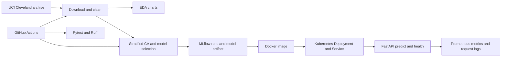

# Heart Disease MLOps Assignment

An end-to-end, reproducible ML project for the UCI Heart Disease Cleveland dataset. The classifier predicts the dataset's binary label (`0` = disease absent; `1` = disease present, derived from original `num` values 1-4). This is an educational experiment, not a clinical diagnostic tool.

## Quick start

Use Python 3.11 or 3.12. From the repository root:

```powershell
python -m venv .venv
.\.venv\Scripts\Activate.ps1
python -m pip install -r requirements.txt
python -m pip install -e .
python scripts\download_data.py
python scripts\eda.py
python scripts\train.py
pytest -q
```

The download script fetches the official UCI archive and extracts `processed.cleveland.data` into `data/raw/`. It writes a cleaned CSV to `data/processed/`. UCI Cleveland has 303 rows and 13 predictors; `?` values become missing values and are imputed inside each training fold. The target is not used as an input. EDA charts and trained artifacts are written to `artifacts/`; local MLflow runs are stored in `mlflow.db`.

View the experiment dashboard with `mlflow ui --backend-store-uri sqlite:///mlflow.db` and open `http://127.0.0.1:5000`.

## Modeling approach

The pipeline compares Logistic Regression and Random Forest with stratified five-fold cross-validation. A small, documented parameter grid is ranked by CV ROC-AUC on the training split; preprocessing (median numeric imputation/scaling and most-frequent categorical imputation/one-hot encoding) is fitted inside each fold. A stratified 80/20 holdout reports accuracy, precision, recall and ROC-AUC. The holdout is reserved until after model selection. The selected full preprocessing/model pipeline is serialized to `artifacts/heart_disease_model.joblib`; `training_summary.json`, evaluation plots, classification reports, and MLflow run artifacts are also generated.

For genuine experimentation, vary the search grids or seed deliberately, inspect the recorded runs, and discuss the trade-offs in the report. Small datasets make scores noisy; do not present them as clinical evidence.

## API and local container

Training must finish before building the image because the trained model is copied into it:

```powershell
docker build -t heart-risk-api:local .
docker run --rm -p 8000:8000 heart-risk-api:local
```

Check `GET http://localhost:8000/health`, `GET http://localhost:8000/metrics`, and `POST http://localhost:8000/predict`. Example body:

```json
{"age":63,"sex":1,"cp":3,"trestbps":145,"chol":233,"fbs":1,"restecg":0,"thalach":150,"exang":0,"oldpeak":2.3,"slope":2,"ca":0,"thal":6}
```

The response contains a binary prediction, model confidence for that class, and a non-clinical-use disclaimer. Request logs include an ID, path, status and latency only; patient payloads are deliberately not logged. Metrics are exposed in Prometheus format at `/metrics`. API health returns `503` before a model artifact is available.

## Local Kubernetes

Choose one local cluster option. Both paths require Docker Desktop's engine and `kubectl`.

### Docker Desktop Kubernetes

In Docker Desktop, open **Settings > Kubernetes**, enable Kubernetes, and apply/restart. Wait for the cluster to start, then confirm `kubectl config current-context` reports `docker-desktop`. The image is already in Docker Desktop's image store, so do not run a Minikube image-load command.

```powershell
docker build -t heart-risk-api:local .
kubectl apply -f deployment/kubernetes.yaml
kubectl rollout status deployment/heart-risk-api
kubectl port-forward service/heart-risk-api 8080:80
```

### Minikube

Install Minikube, then start its Docker driver and load the image into the Minikube node:

```powershell
minikube start --driver=docker
docker build -t heart-risk-api:local .
minikube image load heart-risk-api:local
kubectl apply -f deployment/kubernetes.yaml
kubectl rollout status deployment/heart-risk-api
kubectl port-forward service/heart-risk-api 8080:80
```

With either option, test `http://localhost:8080/health` and the prediction request above. A local Minikube load balancer may need `minikube tunnel`; port-forwarding is the portable local verification path. Prometheus scrape configuration is in `deployment/prometheus.yml`; deploy Prometheus and Grafana in your own cluster to create a dashboard. The manifest exposes the application service via `LoadBalancer`; cloud use also requires publishing the image to a registry and updating its image name.

## CI and tests

GitHub Actions runs Ruff linting, pytest, training, EDA, and uploads outputs on every push and pull request. Dataset download requires network access in the runner. Any lint or test failure stops the job. Tests cover dataset parsing, missing values, binary target mapping, feature validation, and pipeline fit/predict behavior.

## Architecture



## Evidence and submission checklist

Before submission, run the project yourself and populate `screenshots/` with genuine screenshots of EDA outputs, MLflow runs, passing CI, a Docker build and API request, and Kubernetes rollout/API verification. Record the requested short walkthrough video and include its location/link. Replace the report placeholders with your actual run metrics, your interpretation of model errors and limitations, your GitHub repository URL, and cloud URL or local-cluster access instructions. Do not claim a public deployment until you have actually published and verified it.

See [REPORT.md](REPORT.md) for the final-report structure and evidence table.# Heart Disease MLOps Assignment

An end-to-end, reproducible ML project for the UCI Heart Disease Cleveland dataset. The classifier predicts the dataset's binary label (`0` = disease absent; `1` = disease present, derived from original `num` values 1-4). This is an educational experiment, not a clinical diagnostic tool.

## Quick start

Use Python 3.11 or 3.12. From the repository root:

```powershell
python -m venv .venv
.\.venv\Scripts\Activate.ps1
python -m pip install -r requirements.txt
python scripts\download_data.py
python scripts\eda.py
python scripts\train.py
pytest -q
```

The download script fetches the official UCI archive and extracts `processed.cleveland.data` into `data/raw/`. It writes a cleaned CSV to `data/processed/`. UCI Cleveland has 303 rows and 13 predictors; `?` values become missing values and are imputed inside each training fold. The target is not used as an input. EDA charts and trained artifacts are written to `artifacts/`; local MLflow runs are stored under `mlruns/`.

View the experiment dashboard with `mlflow ui --backend-store-uri ./mlruns` and open `http://127.0.0.1:5000`.

## Modeling approach

The pipeline compares Logistic Regression and Random Forest with stratified five-fold cross-validation. A small, documented parameter grid is ranked by CV ROC-AUC on the training split; preprocessing (median numeric imputation/scaling and most-frequent categorical imputation/one-hot encoding) is fitted inside each fold. A stratified 80/20 holdout reports accuracy, precision, recall and ROC-AUC. The holdout is reserved until after model selection. The selected full preprocessing/model pipeline is serialized to `artifacts/heart_disease_model.joblib`; `training_summary.json`, evaluation plots, classification reports, and MLflow run artifacts are also generated.

For genuine experimentation, vary the search grids or seed deliberately, inspect the recorded runs, and discuss the trade-offs in the report. Small datasets make scores noisy; do not present them as clinical evidence.

## API and local container

Training must finish before building the image because the trained model is copied into it:

```powershell
docker build -t heart-risk-api:local .
docker run --rm -p 8000:8000 heart-risk-api:local
```

Check `GET http://localhost:8000/health`, `GET http://localhost:8000/metrics`, and `POST http://localhost:8000/predict`. Example body:

```json
{"age":63,"sex":1,"cp":3,"trestbps":145,"chol":233,"fbs":1,"restecg":0,"thalach":150,"exang":0,"oldpeak":2.3,"slope":2,"ca":0,"thal":6}
```

The response contains a binary prediction, model confidence for that class, and a non-clinical-use disclaimer. Request logs include an ID, path, status and latency only; patient payloads are deliberately not logged. Metrics are exposed in Prometheus format at `/metrics`. API health returns `503` before a model artifact is available.

## Local Kubernetes

Prerequisites: Docker Desktop with Kubernetes enabled, or Minikube, with `kubectl` configured. Build and load the local image, then apply the manifest:

```powershell
docker build -t heart-risk-api:local .
minikube image load heart-risk-api:local
kubectl apply -f deployment/kubernetes.yaml
kubectl rollout status deployment/heart-risk-api
kubectl port-forward service/heart-risk-api 8080:80
```

For Docker Desktop Kubernetes, skip `minikube image load`. Test `http://localhost:8080/health` and the prediction request above. A local Minikube load balancer may need `minikube tunnel`; port-forwarding is the portable local verification path. Prometheus scrape configuration is in `deployment/prometheus.yml`; deploy Prometheus and Grafana in your own cluster to create a dashboard. The manifest exposes the application service via `LoadBalancer`; cloud use also requires publishing the image to a registry and updating its image name.

## CI and tests

GitHub Actions runs Ruff linting, pytest, training, EDA, and uploads outputs on every push and pull request. Dataset download requires network access in the runner. Any lint or test failure stops the job. Tests cover dataset parsing, missing values, binary target mapping, feature validation, and pipeline fit/predict behavior.

## Architecture


## Evidence and submission checklist

Before submission, run the project yourself and populate `screenshots/` with genuine screenshots of EDA outputs, MLflow runs, passing CI, a Docker build and API request, and Kubernetes rollout/API verification. Record the requested short walkthrough video and include its location/link. Replace the report placeholders with your actual run metrics, your interpretation of model errors and limitations, your GitHub repository URL, and cloud URL or local-cluster access instructions. Do not claim a public deployment until you have actually published and verified it.

See [REPORT.md](REPORT.md) for the final-report structure and evidence table.