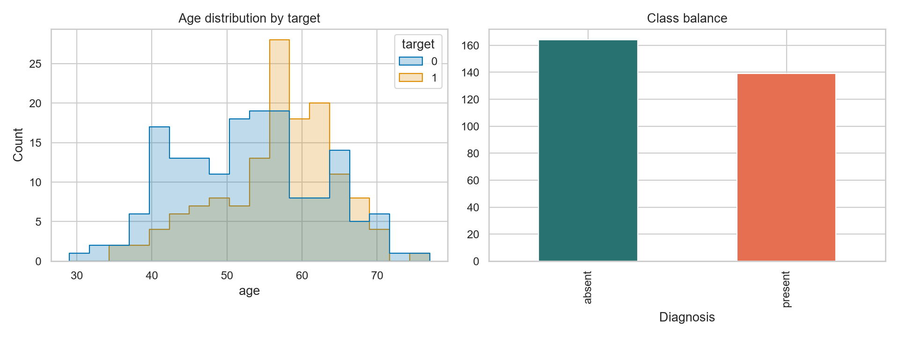
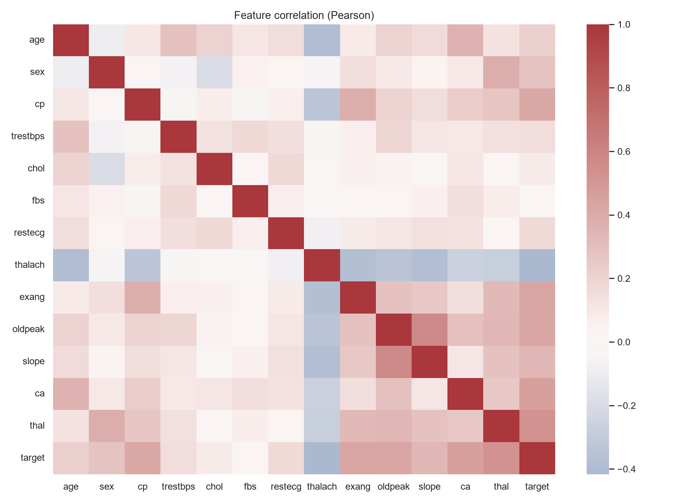
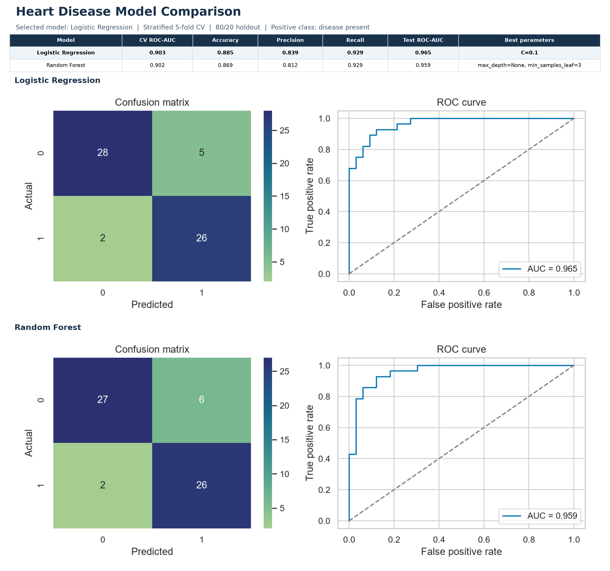
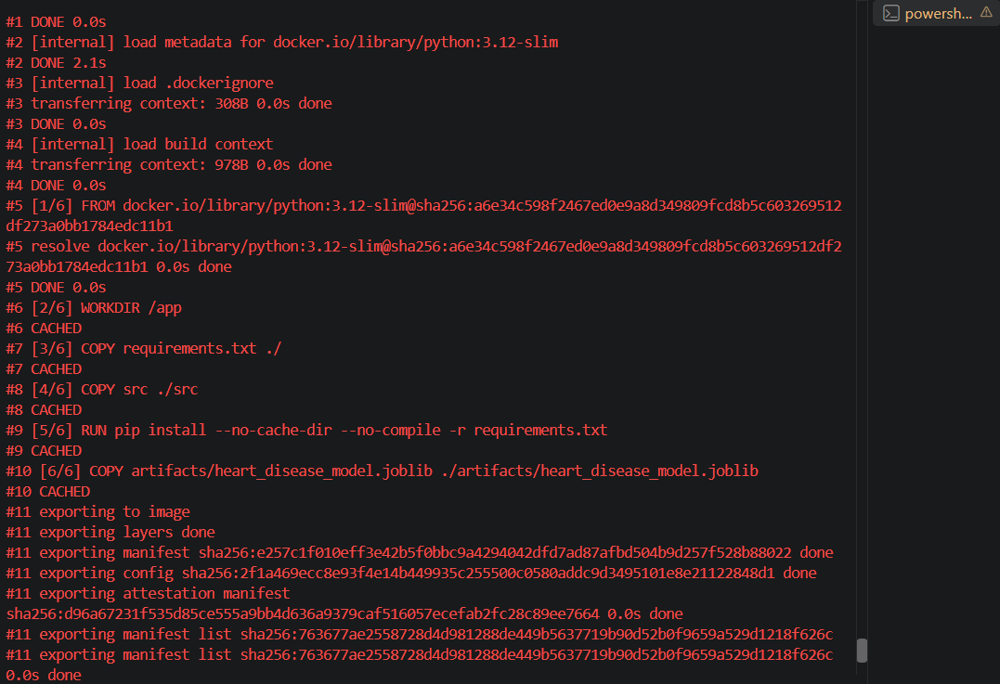
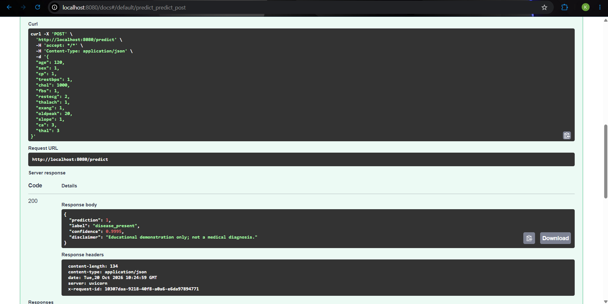
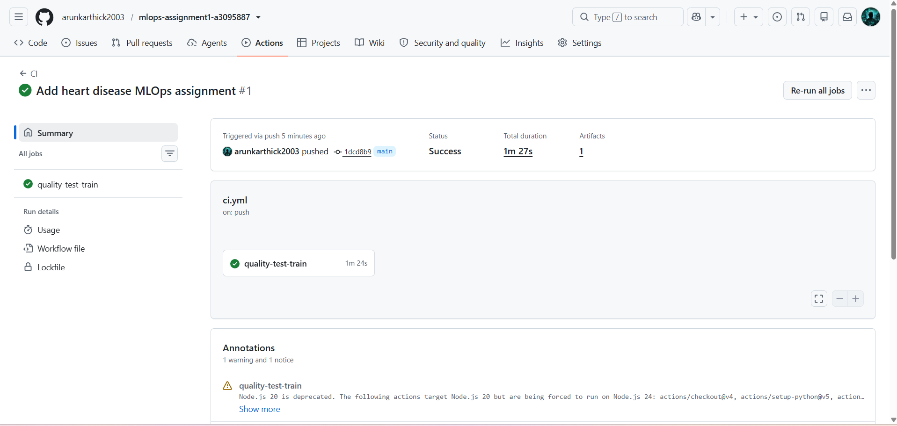
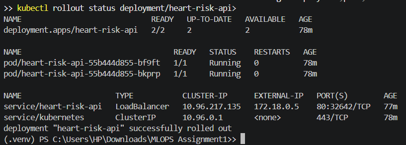
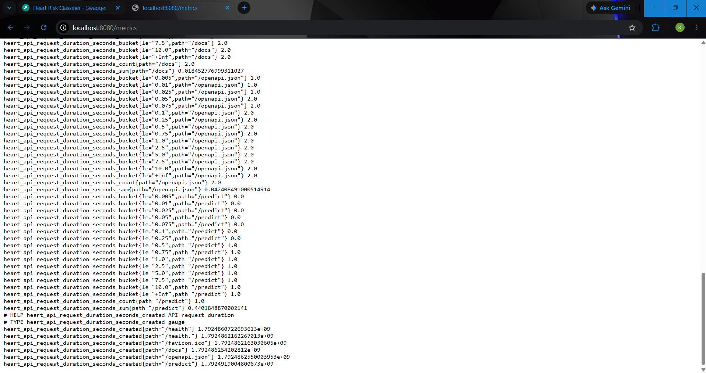

# End-to-End Heart Disease MLOps Report

**Course:** Machine Learning Operations (MLOps), Assignment 01
**Repository:** [github.com/arunkarthick2003/mlops-assignment1-a3095887](https://github.com/arunkarthick2003/mlops-assignment1-a3095887)
**Author account:** `@arunkarthick2003`

> This is an educational machine-learning demonstration, not clinical software. It is not validated for diagnosis, treatment, or patient-care decisions.

## 1. Executive Summary

This project implements a reproducible binary classifier for the Cleveland subset of the UCI Heart Disease dataset. It covers acquisition and preprocessing, exploratory data analysis, comparison of Logistic Regression and Random Forest, MLflow experiment tracking, automated tests and CI, a Dockerized FastAPI service, local Kubernetes deployment, and API logging/metrics.

Logistic Regression with `C=0.1` was selected by stratified five-fold CV ROC-AUC on the training partition. On the separate 61-row holdout, it achieved accuracy `0.8852`, precision `0.8387`, recall `0.9286`, and ROC-AUC `0.9654`. The Random Forest baseline achieved holdout accuracy `0.8689`, precision `0.8125`, recall `0.9286`, and ROC-AUC `0.9589`.

The Docker image built successfully; health, prediction, and metrics endpoints were exercised. The Kubernetes Deployment reached 2/2 ready replicas, and the API was checked through a local port-forward. GitHub Actions run [39411595260](https://github.com/arunkarthick2003/mlops-assignment1-a3095887/actions/runs/39411595260) completed successfully. No public cloud endpoint or Grafana dashboard is claimed.

## 2. Problem, Dataset, and Architecture

The assignment asks for a heart-disease risk classifier delivered with reproducible training and an operational API. The dataset is the processed Cleveland subset from the [UCI Heart Disease collection](https://doi.org/10.24432/C52P4X). It contains 303 observations and 13 predictor variables. The original `num` field has values from zero to four; this project maps zero to the negative class and values one through four to the positive class.

The implementation is divided into acquisition and analysis scripts, a Python package for data/model/API functionality, tests, CI configuration, and Kubernetes/Prometheus configuration. The deployment flow is:

```text
UCI archive -> download/clean -> EDA and training -> MLflow + model artifact
            -> Docker image -> Kubernetes Deployment/Service -> FastAPI
            -> health, prediction, request logs, Prometheus metrics
```

The repository is public at the URL above. The dataset’s UCI citation/DOI is included in the repository documentation.

## 3. Data Acquisition and Exploratory Analysis

`scripts/download_data.py` downloads the official UCI archive and extracts `processed.cleveland.data`. Unknown fields marked `?` are parsed as missing values. The cleaned data is written to `data/processed/heart_disease.csv`; raw source files are reproducible and not required to be committed.

The binary label counts are 164 negative and 139 positive. Six predictor cells are missing: four in `ca` and two in `thal`; all other predictors and the target are complete. No target values are used as features. Missing-value imputation is performed inside the model pipeline rather than by using statistics computed over the full dataset.

EDA scripts create a class-balance/age-distribution figure and a correlation heatmap. The largest absolute Pearson correlations with the binary target in this dataset are `thal` (0.526), `ca` (0.460), `exang` (0.432), `oldpeak` (0.425), and `thalach` (-0.417). Several fields are categorical codes, so their Pearson correlations are descriptive only and should not be interpreted as linear clinical effects or causal relationships.





## 4. Feature Engineering and Training Protocol

The 13 model inputs are `age`, `sex`, `cp`, `trestbps`, `chol`, `fbs`, `restecg`, `thalach`, `exang`, `oldpeak`, `slope`, `ca`, and `thal`. Numeric features are median-imputed and standardized. Categorical codes (`sex`, `cp`, `fbs`, `restecg`, `exang`, `slope`, `ca`, `thal`) are most-frequent-imputed and one-hot encoded with unknown categories ignored. These transformations are part of the scikit-learn pipeline and are fitted inside each CV fold.

The data was divided using a stratified 80/20 holdout and fixed random seed 42. Hyperparameter selection used only the 242-row training partition, with five-fold stratified CV and ROC-AUC as the selection score. Logistic Regression was tested at `C` values 0.1, 1, and 10. Random Forest was tested with `max_depth` in `{None, 5}` and `min_samples_leaf` in `{1, 3}`, also with balanced class weights and a fixed seed.

This protocol gives a reproducible comparison, but a single small holdout is noisy. The reported result should be interpreted as a coursework baseline, not a stable estimate of deployment performance.

## 5. Model Results and Error Analysis

| Candidate | Mean CV ROC-AUC | Holdout accuracy | Holdout precision | Holdout recall | Holdout ROC-AUC | Selected parameters |
| --- | ---: | ---: | ---: | ---: | ---: | --- |
| Logistic Regression | 0.9028 | 0.8852 | 0.8387 | 0.9286 | 0.9654 | `C=0.1` |
| Random Forest | 0.9019 | 0.8689 | 0.8125 | 0.9286 | 0.9589 | `max_depth=None`, `min_samples_leaf=3` |

Logistic Regression leads CV ROC-AUC by approximately 0.0009. Both candidates have the same positive-class recall on the holdout; Logistic Regression has higher accuracy, precision, and holdout ROC-AUC, so it was retained as the final baseline. The positive class is disease present. For the Logistic Regression holdout, the confusion matrix in `[negative, positive]` label order is `[[28, 5], [2, 26]]`: 28 true negatives, 5 false positives, 2 false negatives, and 26 true positives.

For a hypothetical screening workflow, a false negative may be consequential, but this assignment’s model is not a screening recommendation. The decision threshold remains the classifier’s default threshold; no clinical threshold analysis or calibration was performed. ROC-AUC measures ranking over thresholds and does not demonstrate that the predicted confidence values are calibrated probabilities.



## 6. Experiment Tracking and Reproducibility

MLflow experiment `uci-heart-disease-cleveland` uses the local SQLite store `mlflow.db`. Each candidate run records model identity, search parameters, random seed, fold count, CV/holdout metrics, a classification report, and an evaluation plot. The selected preprocessing/model pipeline is serialized as `artifacts/heart_disease_model.joblib`; the training summary is `artifacts/training_summary.json`.

The latest candidate run IDs recorded in the training summary are:

- Logistic Regression: `83dcf44e9edf4296ac210cd0c43fcbbe`
- Random Forest: `5ba36aeea1d64c03a54d813b8a839b89`

The local MLflow UI is started with `mlflow ui --backend-store-uri sqlite:///mlflow.db`. The file `screenshots/mlflow-runs.png` is a formatted run-metrics summary exported from the tracked results; it is not a raw browser capture. The project also retains an experiment UI capture in `screenshots/mlflow-runs2.png`; it includes troubleshooting runs and is not used as the clean candidate comparison figure.

## 7. Model Packaging, API, and Docker

Preprocessing and classification are packaged together in the serialized scikit-learn pipeline. `requirements.txt` lists the Python dependencies, while the Dockerfile installs the application dependencies, adds the `src` package on `PYTHONPATH`, copies the trained model, and runs Uvicorn as a non-root user.

FastAPI provides:

- `GET /health`: returns success when the model artifact is loaded.
- `POST /predict`: validates the 13 numeric feature fields and returns class, label, and confidence for the predicted class.
- `GET /metrics`: exposes request counters and request-duration histograms in Prometheus format.

The sample prediction returned HTTP 200 and included the educational-use disclaimer. The Docker image `heart-risk-api:local` built successfully, and the container’s health, prediction, and metrics endpoints were exercised. Application logs record request ID, method, path, response status, and latency; patient feature payloads are intentionally excluded.





## 8. Testing, CI/CD, and Repository

The test suite covers missing-value parsing, binary target mapping, feature validation, preprocessing/pipeline fit and prediction, API health and prediction behavior, metrics exposure, and HTTP 422 for an incomplete request. Six pytest tests passed locally, and Ruff linting passed.

The GitHub Actions workflow installs dependencies, installs the `src` package, runs Ruff, trains the models, runs pytest, generates EDA figures, and uploads training artifacts plus the MLflow database. The run for commit `1dcd8b9` completed with status **Success** in 1 minute 27 seconds. The workflow artifact contains generated training/EDA outputs; a Docker build is performed locally rather than in this CI workflow.

Repository: [https://github.com/arunkarthick2003/mlops-assignment1-a3095887](https://github.com/arunkarthick2003/mlops-assignment1-a3095887)
CI run: [https://github.com/arunkarthick2003/mlops-assignment1-a3095887/actions/runs/39411595260](https://github.com/arunkarthick2003/mlops-assignment1-a3095887/actions/runs/39411595260)



## 9. Local Kubernetes Deployment and Monitoring

The verified deployment target is Kubernetes running locally through Docker Desktop, not a public cloud. `deployment/kubernetes.yaml` defines a two-replica Deployment with resource requests/limits and HTTP readiness/liveness probes, plus a LoadBalancer Service. The rollout reported two available replicas; both pods were running and ready. The Service was accessed through `kubectl port-forward service/heart-risk-api 8080:80`, with API health returning `{"status":"ok","model":"loaded"}`.

The LoadBalancer address belongs to the local cluster and is not a public endpoint. The public deliverable is the source repository; runtime access instructions are local port-forwarding commands. No public cloud deployment is claimed.

The API exposes Prometheus request-count and latency metrics, and `deployment/prometheus.yml` provides a scrape target configuration. API metrics and request logs were captured. A Prometheus/Grafana stack and dashboard were not deployed; monitoring demonstrated here is the `/metrics` endpoint and application logs.





## 10. Limitations, Conclusion, and References

The dataset has only 303 records and reflects an older clinical cohort. The holdout contains 61 records, so a few classifications materially change reported metrics. There is no external validation, prospective evaluation, calibration assessment, demographic subgroup analysis, drift monitoring, or threshold optimization. The one-hot/scale preprocessing and model selection are reproducible, but they do not remove dataset bias or establish clinical utility. The API must not be connected to a patient-care workflow.

Within those limits, the assignment demonstrates a reproducible workflow from UCI acquisition through model tracking, packaging, CI, local container serving, Kubernetes orchestration, and basic API monitoring. Next steps for a production research prototype would include data governance, representative external data, calibration and subgroup evaluation, versioned model/data artifacts, security review, alerting, and clinical validation by qualified professionals.

**References**

1. UCI Machine Learning Repository, Heart Disease dataset, DOI: [10.24432/C52P4X](https://doi.org/10.24432/C52P4X).
2. scikit-learn documentation: pipelines, preprocessing, model selection, and classification metrics.
3. MLflow documentation: experiment tracking and local backend stores.
4. FastAPI documentation: request validation and API serving.
5. Prometheus documentation: exposition format and scraping.

**Walkthrough video:** `video_presentation_a3095887_compressed.mp4` (approximately 10 minutes 6 seconds; approximately 10.6 MB). The uncompressed source recording is intentionally excluded from Git because it is approximately 636 MB.
